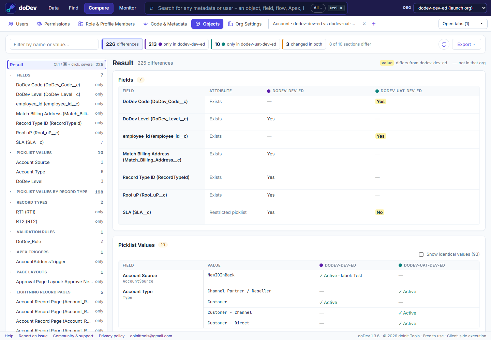

# How to compare a Salesforce object between two orgs

**Short answer:** to check whether an object is the same in a sandbox and production, you open it in Object Manager in both orgs and compare field by field. doDev, a free Chrome extension, compares the whole object in one go and highlights what differs.

## Compare it with doDev

1. [Install doDev](https://chromewebstore.google.com/detail/agcjfjpmlmfbdbgfohficnccnknimhbd?utm_source=dodev-site&utm_medium=how-to) and log into both orgs in the same browser.
2. Open doDev and go to **Compare → Objects**.
3. Type the object, e.g. *Account*, and pick the two orgs.
4. Click **Compare object**.

You get, with the differences highlighted:

- **Object settings** and **every field attribute** – type, length, required, unique, formula, default, help text and more.
- **Picklist values**, also per record type.
- **Record types, validation rules, triggers, record-triggered flows, page layouts and Lightning pages.**
- A tree of **all differences** by section, and the sections that are identical in both orgs.

From an object's page in **Find Any Metadata**, *⇄ Compare with* opens this comparison straight away.

## Doing it without a tool

Open the object in Object Manager in both orgs and compare each field's settings, or retrieve the object with the Salesforce CLI from both orgs and compare the `.object-meta.xml` and field files.

---

More how-to guides: [all guides](./) · [doDev help](../help/#object)
