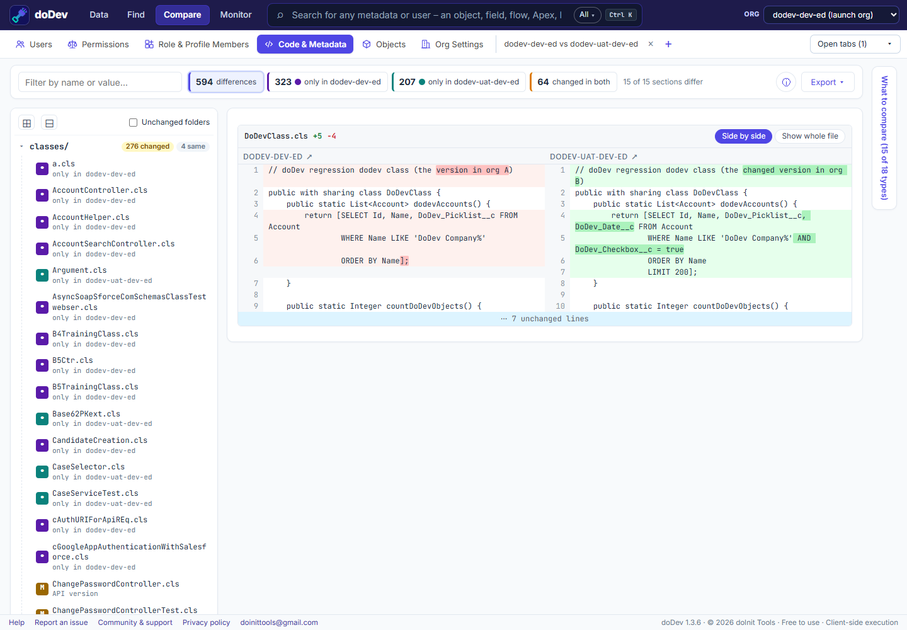

# How to compare Apex and metadata between Salesforce sandbox and production

**Short answer:** change sets don't show what is different between two orgs. The usual way is to retrieve both orgs' metadata with the Salesforce CLI and compare the folders in an editor. doDev, a free Chrome extension, compares the two orgs you are logged into directly and shows a side-by-side diff.

## Compare them with doDev

1. [Install doDev](https://chromewebstore.google.com/detail/agcjfjpmlmfbdbgfohficnccnknimhbd?utm_source=dodev-site&utm_medium=how-to) and log into both orgs in the same browser (e.g. a sandbox and production).
2. Open doDev and go to **Compare → Code & Metadata**.
3. Pick the two orgs. Everything is compared by default; **⚙ What to compare** narrows it to some types or names.
4. Click **Compare code & metadata**.

You get:

- **A project tree** – the same folders as an SFDX project – with changed and identical counts.
- **A side-by-side diff** for each changed file or component; ↑ / ↓ (or j / k) jump between changes.
- **Line endings** – when only Windows / Unix line endings differ, that is said plainly instead of a diff full of identical lines.

For a single class, **Find Any Metadata → ⇄ Compare with** shows the same diff without comparing the whole org.

## Doing it without a tool

Retrieve both orgs with the Salesforce CLI (`sf project retrieve start --manifest package.xml --target-org …`) into two folders, then compare the folders in VS Code or with `git diff --no-index`.

---

More how-to guides: [all guides](./) · [doDev help](../help/#code)
