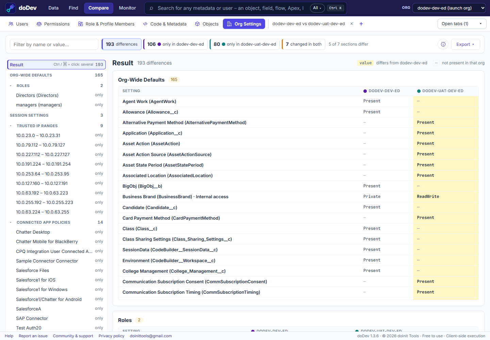

# How to compare settings between two Salesforce orgs

**Short answer:** after a sandbox refresh or before a go-live, you want to know whether the two orgs are set up the same way – sharing defaults, security policies, the role hierarchy. Salesforce has no org-to-org comparison. doDev, a free Chrome extension, lists the differences.

## Compare them with doDev

1. [Install doDev](https://chromewebstore.google.com/detail/agcjfjpmlmfbdbgfohficnccnknimhbd?utm_source=dodev-site&utm_medium=how-to) and log into both orgs in the same browser.
2. Open doDev and go to **Compare → Org Settings**.
3. Pick the two orgs and click **Compare orgs**.

You get, with the values that differ highlighted:

- **Org-wide sharing defaults** for every object.
- **Role hierarchy.**
- **Password and session policies** and **trusted IP ranges.**
- **Connected app policies.**
- **Organization settings.**

A tree on the left lists all differences by section; the sections that are the same in both orgs are kept apart under *Identical in all orgs*.

## Doing it without a tool

Open Sharing Settings, Password Policies, Session Settings, Network Access and the rest in both orgs side by side, or retrieve the settings metadata with the Salesforce CLI and compare the files.

---

More how-to guides: [all guides](./) · [doDev help](../help/#org)
