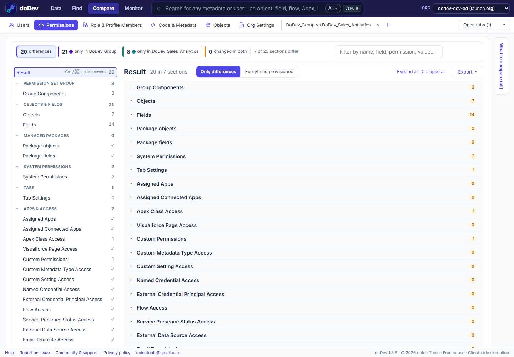

# How to compare permission set groups in Salesforce

**The situation:** permission set groups bundle permission sets for a job – *Sales Rep*, *Sales Manager*. Over time two groups for similar roles overlap or drift, and muting permission sets make it harder still to say what a group really grants. Salesforce shows a group's combined permissions one group at a time. doDev, a free Chrome extension, compares two or more groups side by side.

## Compare them with doDev

1. [Install doDev](https://chromewebstore.google.com/detail/agcjfjpmlmfbdbgfohficnccnknimhbd?utm_source=dodev-site&utm_medium=how-to) and open it from the toolbar while you are logged into Salesforce.
2. Go to **Compare → Permissions**.
3. Pick two to five permission set groups – from one org, or the same group in two orgs.
4. Click **Compare**.

You get:

- **Group components** – the permission sets (and muting permission sets) in each group.
- **The combined permissions after muting** – Salesforce's calculated permissions for the group, so a muted permission doesn't show as granted.
- **Every section** – objects, fields, system permissions, tabs, apps, connected apps, Apex, Visualforce, custom permissions and more – with ✓ where the groups agree.
- **Export** – CSV or Excel, or a gap permission set.

You can also compare a group with a single permission set or a profile – e.g. to check that a new group covers everything an old profile granted.

## Good to know

Record type visibility is not part of a group's calculated permissions, so doDev reads it from the member permission sets (without muting).

Related: [compare two profiles or permission sets](compare-profiles-and-permission-sets) · [compare a profile with a permission set](compare-profile-with-permission-set) · [who has access to a field – including through groups](who-has-access-to-a-field)

---

More how-to guides: [all guides](./) · [doDev help](../help/#ps)
