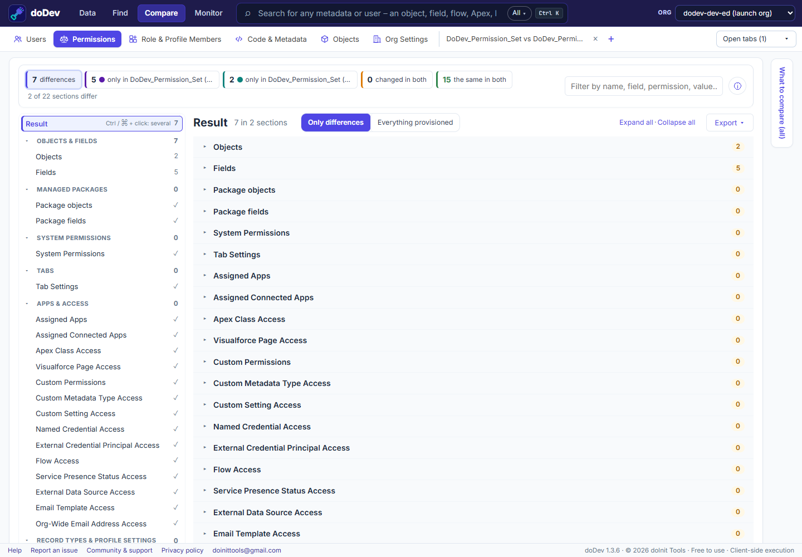

# How to compare a permission set between Salesforce sandbox and production

**The situation:** you deployed a permission set and want to be sure production now matches the sandbox – or you inherited an org and want to know how far the two have drifted. Field permissions are the usual gap: they only deploy for fields included in the same deployment. doDev, a free Chrome extension, compares the permission set in both orgs and lists every difference.

## Compare it with doDev

1. [Install doDev](https://chromewebstore.google.com/detail/agcjfjpmlmfbdbgfohficnccnknimhbd?utm_source=dodev-site&utm_medium=how-to) and log into **both orgs in the same browser**.
2. Open doDev and go to **Compare → Permissions**.
3. Pick the sandbox and the permission set in the first box, production and the same permission set in the second.
4. Click **Compare**.

You get:

- **What differs** – only in the sandbox, only in production, changed in both – by section.
- **Every section, the identical ones too** – objects, fields, system permissions, tabs, apps, connected apps, Apex, Visualforce, custom permissions, custom metadata and settings, named credentials, flows – so you can see the whole permission set was checked, not only the parts that differ.
- **Objects and fields** as a grid, one column per permission, with the field differences one click away.
- **Export → gap permission set** – a deployable file that grants production what the sandbox has. Deploy it with your usual tool.

## A quick post-deployment check

1. Compare the permission set right after the deployment.
2. Look at **Fields** first – new fields without their field permissions are the most common miss.
3. Then **Apex Class Access** and **Custom Permissions** – classes and custom permissions added in the release.
4. Export the CSV for the release notes.

Related: [compare a profile between two orgs](compare-profiles-between-two-salesforce-orgs) · [compare Apex and metadata between orgs](compare-apex-and-metadata-between-orgs) · [compare permission set groups](compare-permission-set-groups)

---

More how-to guides: [all guides](./) · [doDev help](../help/#ps)
