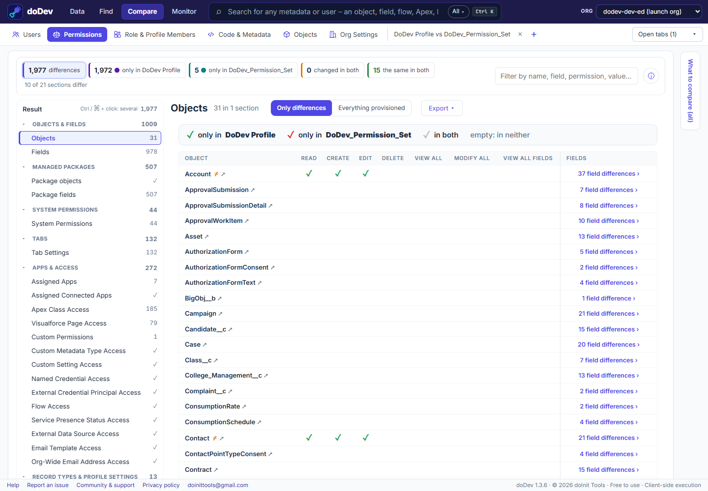

# How to compare a profile with a permission set in Salesforce

**The situation:** Salesforce recommends keeping profiles minimal and granting access through permission sets and permission set groups. To move a profile's permissions into a permission set, you first need to know exactly what the profile grants that the permission set doesn't. Salesforce can't put a profile and a permission set side by side. doDev, a free Chrome extension, can.

## Compare them with doDev

1. [Install doDev](https://chromewebstore.google.com/detail/agcjfjpmlmfbdbgfohficnccnknimhbd?utm_source=dodev-site&utm_medium=how-to) and open it from the toolbar while you are logged into Salesforce.
2. Go to **Compare → Permissions**.
3. Pick the **profile** in the first box and the **permission set** in the second (a permission set group works too).
4. Click **Compare**.

You get:

- **Objects and fields** – a green ✓ for what only the profile grants, a red ✓ for what only the permission set grants, grey for both.
- **System permissions, tabs, apps, connected apps, Apex classes, Visualforce pages, custom permissions** and the other sections both can hold.
- **Export → gap permission set** – *Make the permission set match the profile* downloads a deployable permission set with everything the profile grants and the permission set lacks. Deploy it with your usual tool, assign it, and the profile can be slimmed down.

## What is not compared

Some settings exist only on profiles and can't move to a permission set, so doDev leaves them out of a profile-vs-permission-set comparison and says so: page layout assignments, the default app, default record types, login IP ranges, login hours and the user licence.

## Doing it without a tool

Open the profile and the permission set in Setup and walk through each section, or retrieve both with the Salesforce CLI and compare the `.profile-meta.xml` and `.permissionset-meta.xml` files – the two formats differ, so they don't diff cleanly.

Related: [compare two profiles or permission sets](compare-profiles-and-permission-sets) · [compare permission set groups](compare-permission-set-groups) · [see everything a user can access](everything-a-user-can-access)

---

More how-to guides: [all guides](./) · [doDev help](../help/#ps)
