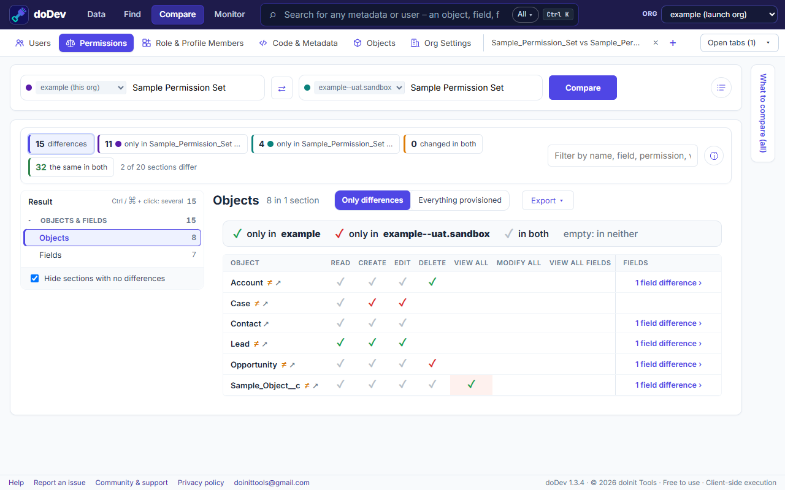

# How to compare two profiles or permission sets in Salesforce

**Short answer:** Salesforce Setup has no compare button for profiles or permission sets. You either open them one by one, export them with the Metadata API and diff the files, or use a tool that lines them up for you. doDev, a free Chrome extension, shows every difference in one table – including between two orgs.

## Compare them with doDev

1. [Install doDev](https://chromewebstore.google.com/detail/agcjfjpmlmfbdbgfohficnccnknimhbd?utm_source=dodev-site&utm_medium=how-to) and open it from the toolbar while you are logged into Salesforce.
2. Go to **Compare → Permissions**.
3. Pick 2 to 5 profiles, permission sets or permission set groups. Each can come from a different org – for example the same permission set in a sandbox and in production.
4. Click **Compare**.

You get:

- **Counts at the top** – differences, only in one, changed in both, the same in both. Click one to filter.
- **Objects and fields** as a grid: one row per object, a column per permission (Read, Create, Edit, Delete, View All, Modify All). A green ✓ is only in the first, a red ✓ only in the second, a grey ✓ in both.
- **Every other section** – system permissions, app permissions, Apex classes, Visualforce pages, tabs, custom permissions and more.
- **Export** to CSV or Excel, or as a deployable *gap permission set* that grants one side what the other has.

## Comparing two users instead

When the question is "why can Anna do this and Ben can't?", use **Compare → Users**. It combines each user's profile, permission sets and groups and says which one grants each difference.

## Doing it without a tool

- **Enhanced profile list views** (Setup → Profiles → create a list view) show a few chosen permissions for many profiles, but not object or field access, and not permission sets.
- **Metadata API:** retrieve both profiles or permission sets (for example with the Salesforce CLI) and compare the XML files. It works, but profiles only include what you retrieve them with, so the files are easy to misread.

## Common questions

**Can I compare a permission set group?** Yes – doDev uses the group's combined permissions, after muting.

**Does it change anything in my org?** No. Comparing only reads. doDev runs in your browser with your existing Salesforce login; nothing is installed in the org.

---

More how-to guides: [all guides](./) · [doDev help](../help/#ps)
