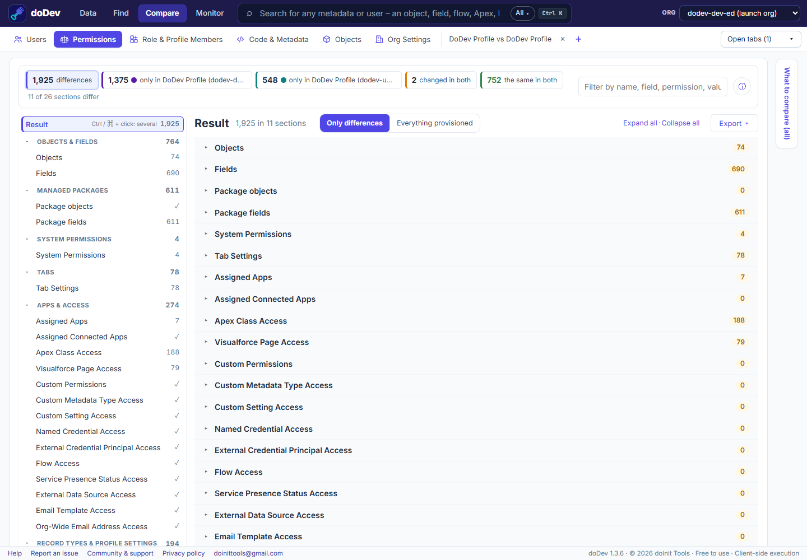

# How to compare a profile between two Salesforce orgs

**The situation:** a profile is "the same" in your sandbox and in production – until a user says something works in one and not the other. Profiles drift: a field added in production without its field-level security, a deployment that only carried part of the profile, a manual change after a refresh. Salesforce can't compare a profile across orgs. doDev, a free Chrome extension, does it in one click.

## Compare the profile across orgs with doDev

1. [Install doDev](https://chromewebstore.google.com/detail/agcjfjpmlmfbdbgfohficnccnknimhbd?utm_source=dodev-site&utm_medium=how-to) and log into **both orgs in the same browser** – e.g. your UAT sandbox in one tab and production in another.
2. Open doDev and go to **Compare → Permissions**.
3. In the first box pick the first org and the profile; in the second box pick the other org and the same profile.
4. Click **Compare**.

You get:

- **Counts** – differences, only in the first org, only in the second, changed in both, the same in both. Click one to filter.
- **Every section** of the profile: objects, fields, managed package objects and fields, system permissions, tabs, assigned apps and connected apps, Apex classes, Visualforce pages, custom permissions, custom metadata and settings, named credentials, flows, record types and page layout assignments. Sections that are the same are marked ✓, so you can see everything was checked.
- **Items matched by API name**, not record Id – which is what makes a cross-org comparison meaningful.
- **Export** – CSV or Excel for the review, or a *gap permission set* with what one org's profile grants and the other's lacks.

## Why profiles drift between orgs

- **Partial deployments** – a profile deployed with the Metadata API only carries the permissions for the components in the same deployment.
- **New fields** created directly in production get field-level security only on the profiles chosen at that moment.
- **Sandbox refreshes** copy production, but changes made in the sandbox afterwards don't flow back.

## Doing it without a tool

Retrieve the profile from both orgs with the Salesforce CLI and compare the XML. Include every object, field, class and page in the same `package.xml`, or the retrieved profile leaves those permissions out and the comparison looks cleaner than it is.

Related: [compare two profiles or permission sets in one org](compare-profiles-and-permission-sets) · [compare a user in two orgs](compare-users-in-two-salesforce-orgs) · [compare a permission set between sandbox and production](compare-permission-sets-between-sandbox-and-production)

---

More how-to guides: [all guides](./) · [doDev help](../help/#ps)
