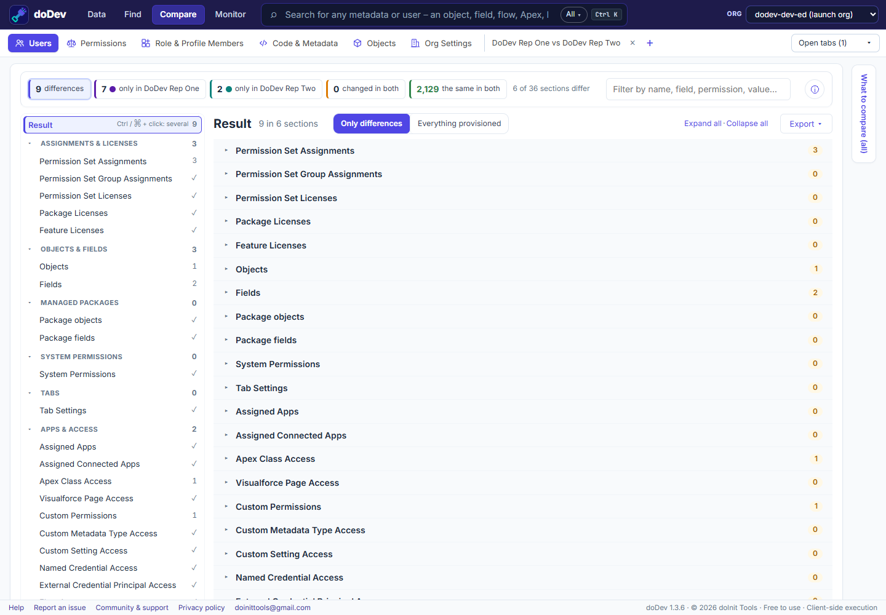

# How to compare two users in Salesforce – why can one do what another can't?

**Short answer:** two users with the same job title often have different access, because it adds up from a profile, several permission sets and permission set groups – plus licences, public groups, queues and the role. Salesforce has no side-by-side view of two users. doDev, a free Chrome extension, compares them and says what grants each difference.

## Compare them with doDev

1. [Install doDev](https://chromewebstore.google.com/detail/agcjfjpmlmfbdbgfohficnccnknimhbd?utm_source=dodev-site&utm_medium=how-to) and open it from the toolbar while you are logged into Salesforce.
2. Go to **Compare → Users**.
3. Pick 2 to 5 users – from one org, or the same person in a sandbox and production.
4. Click **Compare**.

You get:

- **Every permission** – objects, fields, system and app permissions, Apex, pages, tabs, custom permissions – combined from each user's profile, permission sets and groups.
- **Which profile, permission set or group grants it**, for every difference.
- **The rest of the picture** – permission set assignments, licences, public groups, queues, teams, territories, the role path and the user record itself.
- **Export** to CSV or Excel, or a deployable *gap permission set* that gives one user what the other has.

## Doing it without a tool

Open both users' records, note their profile and every permission set and group, and compare those one by one in Setup – or query `PermissionSetAssignment` for each user and diff the permissions yourself.

Related: [compare a user in two Salesforce orgs](compare-users-in-two-salesforce-orgs) · [see everything a user can access](everything-a-user-can-access) · [role and profile members](role-and-profile-members)

---

More how-to guides: [all guides](./) · [doDev help](../help/#users)
