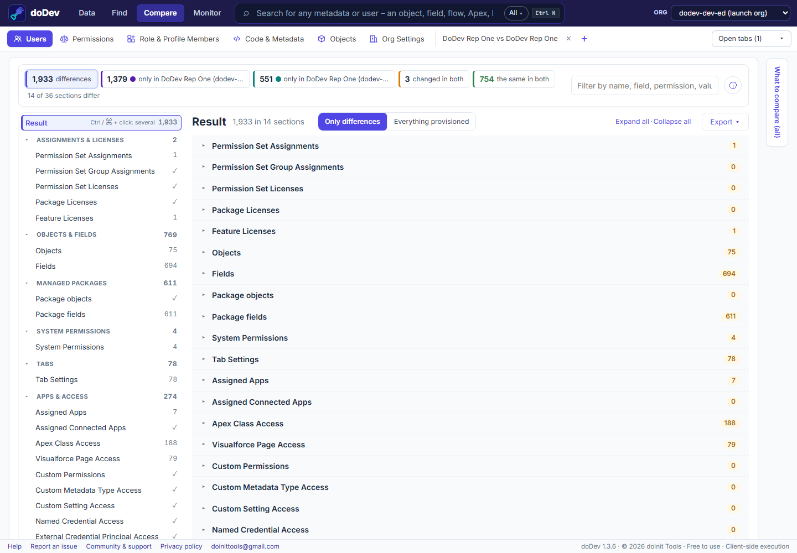

# How to compare a user in two Salesforce orgs

**The situation:** "It worked in UAT." A tester could do something in the sandbox, but the same person can't in production. Their access is the sum of a profile, permission sets, permission set groups, licences and more – in two orgs. Salesforce can't compare a user across orgs. doDev, a free Chrome extension, puts the two side by side.

## Compare the user across orgs with doDev

1. [Install doDev](https://chromewebstore.google.com/detail/agcjfjpmlmfbdbgfohficnccnknimhbd?utm_source=dodev-site&utm_medium=how-to) and log into **both orgs in the same browser**.
2. Open doDev and go to **Compare → Users**.
3. In the first box pick the first org and the user; in the second box pick the other org and the same person. (Sandbox usernames usually carry a suffix such as `.uat` – search by name.)
4. Click **Compare**.

You get:

- **Assignments and licences** – permission sets, permission set groups, permission set licences, package and feature licences in each org.
- **Every permission**, combined from the profile, permission sets and groups – objects, fields, system permissions, tabs, apps, Apex, pages, custom permissions and more.
- **Via what** – each difference says which profile, permission set or group grants it, in which org.
- **Groups, queues, teams, territories, the role path and the user record** – e.g. a different role or a missing public group explains a sharing difference.
- **Export** – CSV or Excel, or a *gap permission set* with what the user has in one org and lacks in the other.

## Common causes

- A **permission set assigned in the sandbox** but never in production (assignments are data, not metadata – they don't deploy).
- A **permission set licence** available in one org only.
- The **profile itself differs** between the orgs – see [compare a profile between two orgs](compare-profiles-between-two-salesforce-orgs).

Related: [compare two users in one org](compare-two-users) · [see everything a user can access](everything-a-user-can-access)

---

More how-to guides: [all guides](./) · [doDev help](../help/#users)
