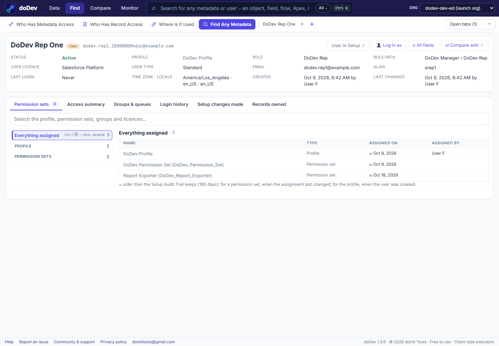

# How to see everything a Salesforce user can access

**Short answer:** a user's access is the sum of their profile, every permission set and every permission set group. Salesforce's user page lists those assignments, but to know what they add up to you open each one. doDev, a free Chrome extension, shows the combined access on one page – and what grants each part.

## See it with doDev

1. [Install doDev](https://chromewebstore.google.com/detail/agcjfjpmlmfbdbgfohficnccnknimhbd?utm_source=dodev-site&utm_medium=how-to) and open it from the toolbar while you are logged into Salesforce.
2. Press **Ctrl+K** (⌘K on a Mac), type the user's name and pick them.
3. Open the **Access summary** tab.

You get:

- **Objects** – every object with the user's level (Read, Create, Edit, Delete, View All, Modify All), key Sales and Service objects first, then custom objects, then the rest. Filter by level, e.g. only objects with *View All* or *Modify All*.
- **Fields** – grouped by object, filtered by Read or Edit.
- **System permissions, tabs, Apex classes, Visualforce pages, custom permissions, apps** and more.
- **Granted by** – the profile, permission set or group behind each line.

From the same page, **👤 Log in as** opens Salesforce's own login-as (when you are allowed to).

## Related questions

- *Why can this user do something another can't?* – [compare two users](compare-two-users).
- *Who has this one permission?* – [users with a system permission](users-with-a-system-permission).

---

More how-to guides: [all guides](./) · [doDev help](../help/#inspect)
