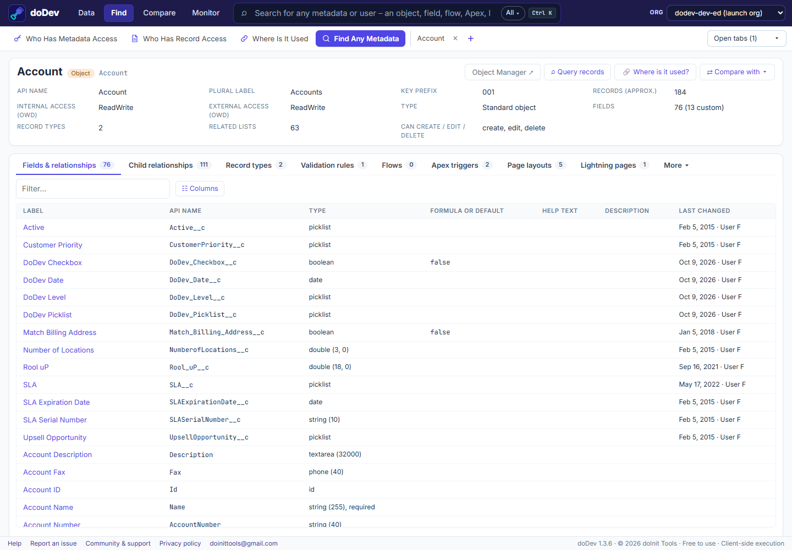

# How to find any metadata in a Salesforce org

**Short answer:** Setup's Quick Find searches the Setup menu, not your metadata. To find a field, a flow or an Apex class you open Object Manager, the Flows list or Apex Classes and search each one. doDev, a free Chrome extension, searches all of them from one box and opens one page with everything about the item.

## Find it with doDev

1. [Install doDev](https://chromewebstore.google.com/detail/agcjfjpmlmfbdbgfohficnccnknimhbd?utm_source=dodev-site&utm_medium=how-to) and open it from the toolbar while you are logged into Salesforce.
2. Press **Ctrl+K** (⌘K on a Mac) or click the search box at the top.
3. Type part of a name – an object, field, flow, Apex class or trigger, LWC, Aura, Visualforce page, profile, permission set, user, role, group, custom label, static resource, email template, Lightning page or validation rule. Results show as they arrive; **All ▾** narrows to one type.
4. Pick a result to open its page.

Each page has the details and tabs that fit the item:

- **An object** – its fields (type, formula or default, help text…), page layouts and their assignments, record types, list views, buttons and more.
- **Code** (Apex, triggers, LWC, Visualforce) – with line numbers and colours, and *Find in file*.
- **⇄ Compare with ▾** – the same item in another org you are logged into, side by side.
- A managed package's items show their namespace, so two with the same name are easy to tell apart.

## Doing it without a tool

- **Setup → Quick Find** – finds Setup pages, not your fields or classes.
- **Object Manager**, **Flows**, **Apex Classes**, **Custom Labels**… – each has its own list and search.
- **Tooling API** – queries such as `SELECT Id, Name FROM ApexClass WHERE Name LIKE '%Invoice%'`.

---

More how-to guides: [all guides](./) · [doDev help](../help/#inspect)
