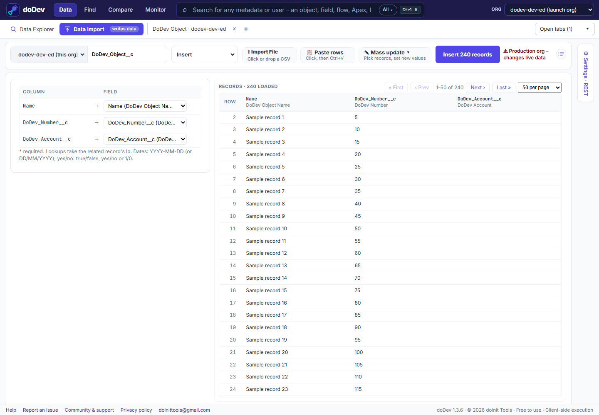

# How to import, update or delete Salesforce records from a CSV or Excel

**Short answer:** the Data Import Wizard covers a limited set of objects and can't delete, and Data Loader is a desktop application to install. doDev, a free Chrome extension, loads, updates or deletes records of any object from a CSV file or rows pasted from Excel – and shows the rows that will likely fail before anything is sent.

## Load records with doDev

1. [Install doDev](https://chromewebstore.google.com/detail/agcjfjpmlmfbdbgfohficnccnknimhbd?utm_source=dodev-site&utm_medium=how-to) and open it from the toolbar while you are logged into Salesforce.
2. Go to **Data → Data Import**.
3. Pick the **object** and the **Operation** – Insert, Update (by Id), Upsert (by an external Id), Delete or Hard delete.
4. Bring the records: **⬆ Import file** (or drop a CSV), **📋 Paste rows** (Ctrl+V straight from Excel or Google Sheets), or **✎ Mass update** – pick records from a query, list view, report or pasted Ids and give a field one new value.
5. Check the **mapping** (columns to fields – matched by name) and the rows marked *Possible error*: missing required fields, unknown picklist values, bad dates.
6. Click the run button, e.g. **Update 450 records**. Results appear as each batch finishes; **⬇ Results CSV** has every row's Id or error.

**⚙ Settings** (as in Data Loader): REST, Bulk API or Bulk API 2.0, batch size, the date format in your file, whether blank cells clear a field, serial mode and assignment rules.

## Doing it without a tool

- **Data Import Wizard** (Setup) – accounts, contacts, leads, solutions, campaign members and custom objects, up to 50,000 records; no delete.
- **Data Loader** – Salesforce's desktop application: every object and operation, but it has to be installed and kept up to date.

## Common questions

**Can I undo an import?** No tool can. Deleted records go to the Recycle Bin for 15 days (hard-deleted ones don't). Keep your file and the results CSV.

**Does it warn me on production?** Yes – a production org gets a warning next to the run button.

---

More how-to guides: [all guides](./) · [doDev help](../help/#import)
