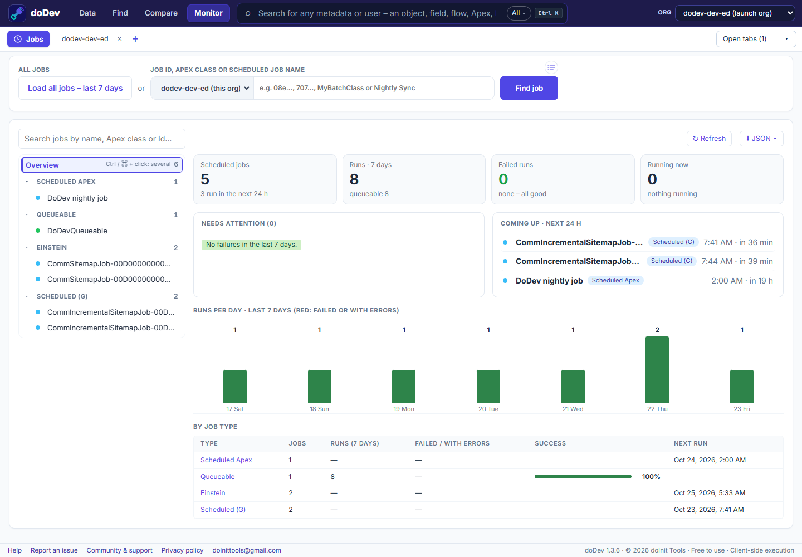

# How to monitor scheduled and failed Apex jobs in Salesforce

**Short answer:** Setup splits jobs across two pages – *Scheduled Jobs* (what is scheduled) and *Apex Jobs* (each run) – and neither shows a job's history at a glance. doDev, a free Chrome extension, shows every job with its recent runs, failures and next run.

## Check them with doDev

1. [Install doDev](https://chromewebstore.google.com/detail/agcjfjpmlmfbdbgfohficnccnknimhbd?utm_source=dodev-site&utm_medium=how-to) and open it from the toolbar while you are logged into Salesforce.
2. Go to **Monitor → Jobs**.
3. Click **Load all jobs – last 7 days**, or type a job Id, an Apex class or a scheduled job name and press **Enter** to go straight to one job.

You get:

- **Overview** – scheduled jobs, runs in 7 days, failed runs, what is running now, *Needs attention* (failures, worst first) and *Coming up* in the next 24 hours.
- **Every job by type** – Scheduled, Batch, Queueable and Future Apex, scheduled flows – with a dot for how it is doing and a 7-day grid of results.
- **A job's page** – the schedule in words (with its cron expression), a countdown to the next run, each run as a bar, and the latest error with Salesforce's full message.
- **Times in your Salesforce time zone.**

## Doing it without a tool

- **Setup → Scheduled Jobs** – what is scheduled and the next run.
- **Setup → Apex Jobs** – each run, its status and the first error.
- **SOQL** – `SELECT ApexClass.Name, JobType, Status, NumberOfErrors, ExtendedStatus, CreatedDate FROM AsyncApexJob WHERE CreatedDate = LAST_N_DAYS:7`.

---

More how-to guides: [all guides](./) · [doDev help](../help/#jobs)
