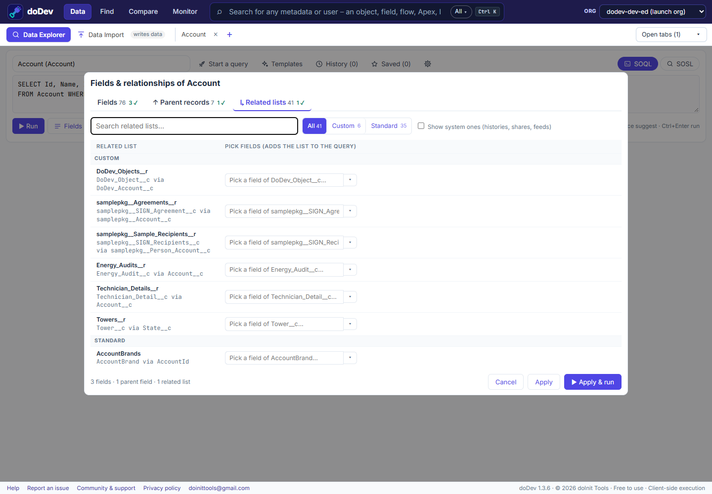

# How to query Salesforce data without writing SOQL

**Short answer:** reports need a report type and list views show one object, so for anything ad hoc admins end up writing SOQL in the Developer Console. doDev, a free Chrome extension, builds the query for you: pick an object, check the fields – including fields of parent records and related lists – and run.

## Query with doDev

1. [Install doDev](https://chromewebstore.google.com/detail/agcjfjpmlmfbdbgfohficnccnknimhbd?utm_source=dodev-site&utm_medium=how-to) and open it from the toolbar while you are logged into Salesforce.
2. Go to **Data → Data Explorer** and type the object, e.g. *Account*. A starter query appears.
3. Click **☰ Fields & relationships…** and check the fields you want. A lookup such as *Owner* shows its fields, and *Go further* reaches its own lookups (Owner › Manager). A related list such as *Contacts* adds a subquery when you check one of its fields.
4. Click **▶ Apply & run**.

You can also:

- **Start from a list view, a report or a record**, or paste a list of Ids or names.
- **Write SOQL yourself** – the editor suggests objects, fields, relationships, picklist values and date literals as you type (Ctrl+Space).
- **Filter the results** as you type, sort and resize columns, and narrow by related records (*With Contacts* / *Without Contacts*).
- **Export** to Excel, CSV or JSON – copy or download.
- **Save** queries you use often; your last 100 are kept in *History*.

## Doing it without a tool

- **Reports** – good for business users, but each needs a report type that includes the objects you want.
- **Developer Console → Query Editor** – write SOQL by hand; no suggestions for field names.
- **Salesforce CLI** – `sf data query --query "SELECT …"` for scripts.

## Common questions

**Can it change data?** Data Explorer only reads. To update the records you found, send them to [Data Import](import-update-delete-records-from-csv) – it shows a preview and asks before anything is saved.

**Does it work with large results?** Yes – it keeps loading past 2,000 rows, and exports have every loaded row.

---

More how-to guides: [all guides](./) · [doDev help](../help/#data)
