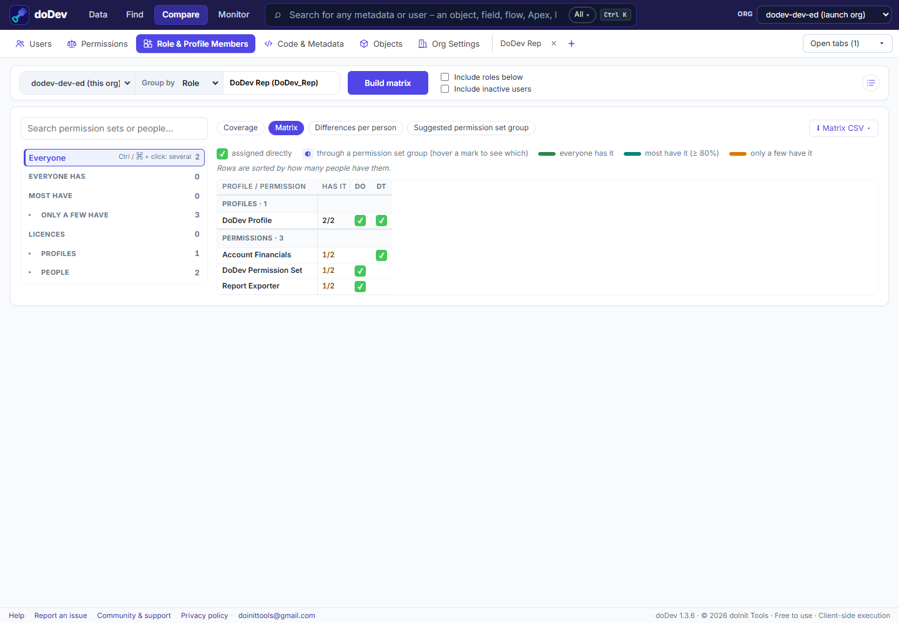

# What do all users in a role or profile have – and who is different?

**Short answer:** people in the same role or profile drift apart over time – one gets an extra permission set, another misses one. Salesforce lists the users of a profile, but not what they hold beyond it. doDev, a free Chrome extension, builds a matrix of everyone in the role or profile and what they hold.

## Check it with doDev

1. [Install doDev](https://chromewebstore.google.com/detail/agcjfjpmlmfbdbgfohficnccnknimhbd?utm_source=dodev-site&utm_medium=how-to) and open it from the toolbar while you are logged into Salesforce.
2. Go to **Compare → Role & Profile Members**.
3. Pick a role (optionally with the roles below it) or a profile.
4. Click **Build matrix**.

You get:

- **Everyone has / Most have / Only a few have** – the permission sets, groups and licences, by how many people hold them.
- **People** – those who differ from the rest first. Click a permission set to see who has it and who is missing it, or a person to see what they're missing.
- **Matrix** – profiles first, then permission sets, groups and licences, one column per person.
- **Suggested permission set group** – what everyone in the role should share, with a deployable file and an assignment plan.

## Doing it without a tool

Setup → Profiles → the profile → *View Users* lists the people; for each one you open their permission set assignments. A query on `PermissionSetAssignment` filtered by `Assignee.ProfileId` or `Assignee.UserRoleId` gives the raw list to pivot in a spreadsheet.

---

More how-to guides: [all guides](./) · [doDev help](../help/#persona)
