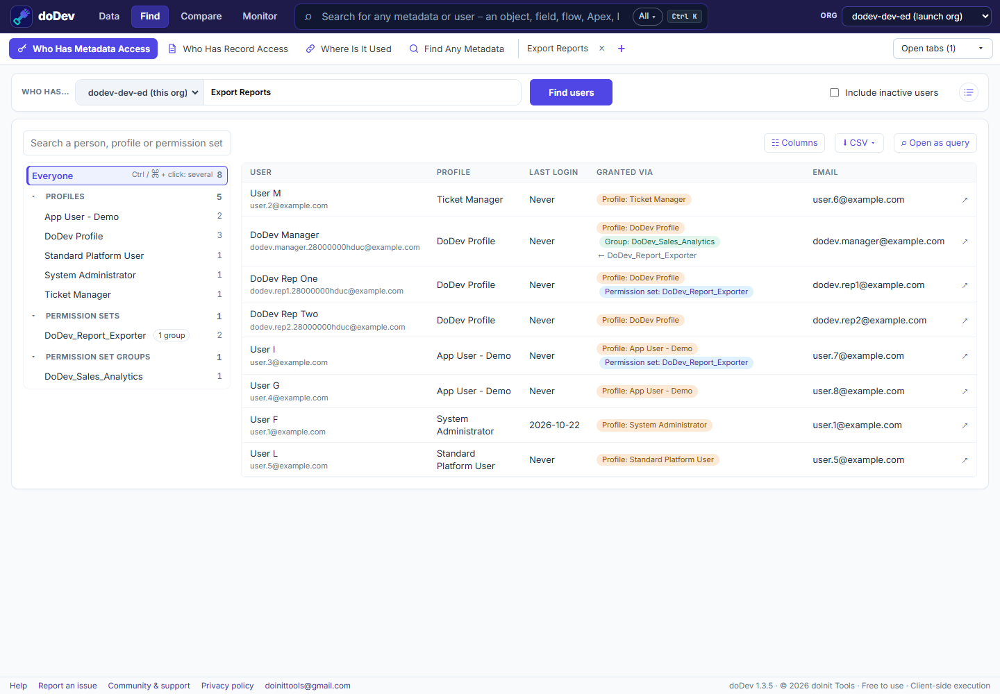

# How to find users with a system permission in Salesforce

**Short answer:** Salesforce has no Setup page that lists the users holding a system permission such as *Export Reports*, *Modify All Data* or *View All Data*. You have to check every profile and permission set, or query the permission fields yourself. doDev, a free Chrome extension, lists the users and where each one gets the permission.

## Find them with doDev

1. [Install doDev](https://chromewebstore.google.com/detail/agcjfjpmlmfbdbgfohficnccnknimhbd?utm_source=dodev-site&utm_medium=how-to) and open it from the toolbar while you are logged into Salesforce.
2. Go to **Find → Who Has Metadata Access**.
3. Type the permission's name, e.g. *Export Reports*, and pick it.
4. Click **Find users**.

You get every user with the permission, and under **Granted via** the profile, permission set or permission set group that gives it. The tree on the left groups them by *Profiles*, *Permission sets* and *Permission set groups*. A permission set that sits in groups shows a **2 groups** button that lists those groups.

The same search works for objects, fields, Apex classes, Visualforce pages, custom permissions, apps, connected apps and flows.

## Good permissions to review regularly

- **Export Reports** – who can take data out of the org as a file.
- **Modify All Data** and **View All Data** – who can see or change every record, whatever the sharing.
- **Manage Users**, **Customize Application** and **Author Apex** – who can change the org itself.

## Doing it without a tool

Each system permission is a field on `PermissionSet` (profiles have one too). For example:

`SELECT Assignee.Name, PermissionSet.Label, PermissionSet.IsOwnedByProfile FROM PermissionSetAssignment WHERE PermissionSet.PermissionsExportReport = true AND Assignee.IsActive = true`

This covers profiles and permission sets. Permission set groups need a second look, because their permissions come from the sets inside them.

---

More how-to guides: [all guides](./) · [doDev help](../help/#who)
