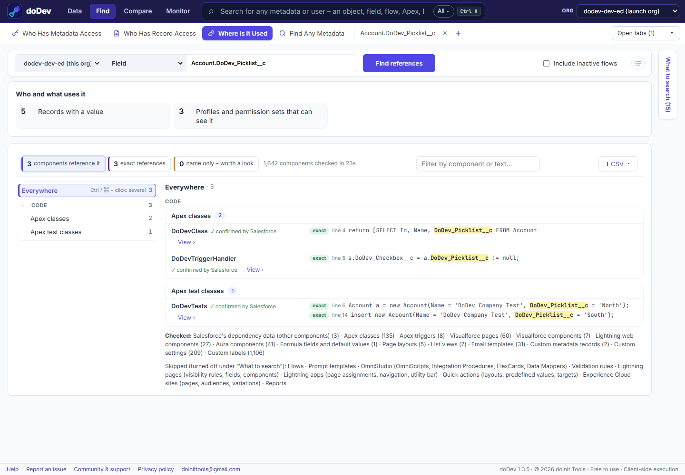

# How to find where a field is used in Salesforce

**Short answer:** Salesforce's **Where is this used?** button on a custom field lists many references, but not all of them – Apex that builds field names as text, reports, list views and several other places are easy to miss. doDev, a free Chrome extension, searches the places you choose and shows each reference with the line that matches.

## Find the references with doDev

1. [Install doDev](https://chromewebstore.google.com/detail/agcjfjpmlmfbdbgfohficnccnknimhbd?utm_source=dodev-site&utm_medium=how-to) and open it from the toolbar while you are logged into Salesforce.
2. Go to **Find → Where Is It Used**.
3. Choose **Field** and type it, e.g. `Account.DoDev_Picklist__c`. It also works for objects, profiles, roles, groups, permission sets, Apex classes, labels, custom permissions, record types or any text.
4. In **What to search** (on the right), check the places – Apex, triggers, Visualforce, Lightning components, formulas, page layouts, list views, email templates, custom metadata and more. The slower ones, such as flows, validation rules and reports, can be added too.
5. Click **Find references**.

You get:

- **Who and what uses it** – e.g. how many records have a value, and how many profiles and permission sets can see the field.
- **Each reference** with its line and the match highlighted, marked **exact** or **name only** (a match on the name that may be something else).
- **View ›** to open the component.

## Before you delete a field

- Check the references above – code and formulas will stop the deletion, but reports, list views and integrations won't.
- Look at how many records have a value: deleting the field deletes that data (it can be restored for 15 days).
- Search the field's API name in your integrations and external code too.

---

More how-to guides: [all guides](./) · [doDev help](../help/#refs)
