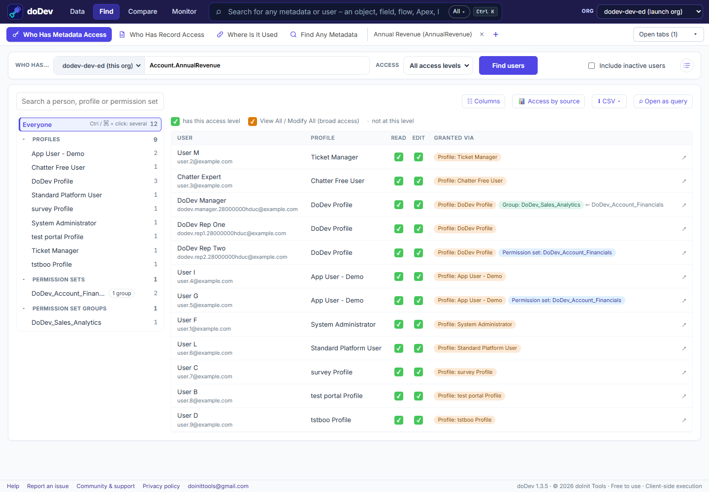

# How to see who has access to a field in Salesforce

**Short answer:** field-level security in Setup shows the field's access per profile only. Permission sets and permission set groups are not on that page, so you can't see from it which *users* can read or edit the field. doDev, a free Chrome extension, lists every user with access and what gives it to them.

## Find them with doDev

1. [Install doDev](https://chromewebstore.google.com/detail/agcjfjpmlmfbdbgfohficnccnknimhbd?utm_source=dodev-site&utm_medium=how-to) and open it from the toolbar while you are logged into Salesforce.
2. Go to **Find → Who Has Metadata Access**.
3. Type the object and a dot, e.g. `Account.`, and pick the field (e.g. *Annual Revenue*).
4. Leave **Access** on *All access levels* (or pick *Read* or *Edit* only) and click **Find users**.

You get:

- **Every user** with a ✓ for Read and Edit.
- **Granted via** – the profile, permission set or permission set group behind each user's access. A group also shows the permission set inside it that carries the access.
- **A tree on the left** with *Profiles*, *Permission sets* and *Permission set groups*, each with a head count. Click one to see just its users.
- **📊 Access by source** – a chart of how many people each profile or permission set gives Read or Edit.
- **⬇ CSV**, and **☷ Columns** to add any user field, such as Email or Department.

## Doing it without a tool

- **Setup → Object Manager → the object → Fields & Relationships → the field → Set Field-Level Security** shows the profiles only.
- For permission sets, query the `FieldPermissions` object, for example
  `SELECT Parent.Label, PermissionsRead, PermissionsEdit FROM FieldPermissions WHERE Field = 'Account.AnnualRevenue'`
  and then look up who is assigned to each permission set in `PermissionSetAssignment`.

## Common questions

**Does field access mean they can see every record?** No. Field access says whether a user can see the field at all; record sharing decides which records. See [who can see a record](why-can-a-user-see-a-record).

**Does it include inactive users?** Only if you check *Include inactive users*.

---

More how-to guides: [all guides](./) · [doDev help](../help/#who)
