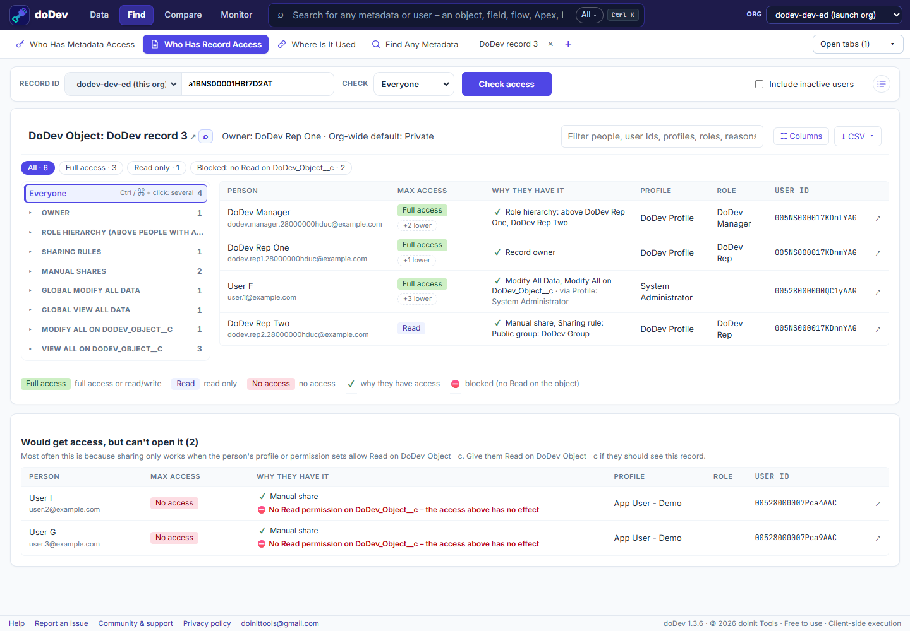

# How to see who can access a record in Salesforce – and why

**Short answer:** in Salesforce you can check one user at a time (the record's *Sharing Hierarchy*, or a query on `UserRecordAccess`), but there is no list of everyone with access and the reason for each. doDev, a free Chrome extension, lists every person who can open the record, their access level and why.

## Check it with doDev

1. [Install doDev](https://chromewebstore.google.com/detail/agcjfjpmlmfbdbgfohficnccnknimhbd?utm_source=dodev-site&utm_medium=how-to) and open it from the toolbar while you are logged into Salesforce.
2. Go to **Find → Who Has Record Access**.
3. Paste the record ID (15 or 18 characters) and leave **Check** on *Everyone*.
4. Click **Check access**.

You get:

- **Everyone with access** and their **highest access** – Full access, Read/Write or Read only.
- **Why they have it** – owner, role hierarchy, sharing rules, manual shares, teams, territories, View All or Modify All on the object, global View All Data or Modify All Data, or the parent record.
- **Pills** to filter: *Full access*, *Read/Write*, *Read only*, *Blocked* – click one or several.
- **Blocked people** – shared the record, but their profile and permission sets don't allow Read on the object, so the share has no effect. This is one of the most common reasons a user "should" see a record but can't.
- **Specific users** instead of *Everyone* to put a few people side by side.

## Why a user can't see a record

1. **No Read on the object** – sharing never overrides object permissions. Give Read through a permission set.
2. **Org-wide default is Private** and nothing shares the record with them: they are not the owner, not above the owner in the role hierarchy, and no sharing rule, team or manual share includes them.
3. **Controlled by parent** – for a detail record, the access comes from the parent record.

---

More how-to guides: [all guides](./) · [doDev help](../help/#record)
